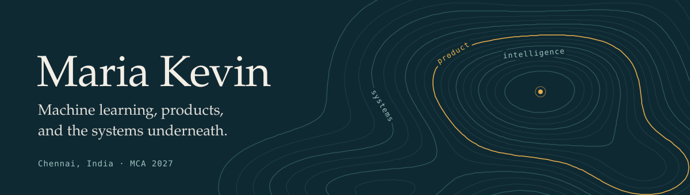

  

<h1 align="center">Make intelligence useful. Make systems understandable.</h1>

  I'm <strong>Maria Kevin</strong>, an MCA student in Chennai who builds software in the space between 
  machine learning, thoughtful products and the systems that hold them up.

  <a href="#the-idea">The idea</a> &nbsp;·&nbsp;
  <a href="#software-that-shows-its-work">What connects my work</a> &nbsp;·&nbsp;
  <a href="#selected-builds">Selected builds</a> &nbsp;·&nbsp;
  <a href="#what-i-work-with">Tools</a> &nbsp;·&nbsp;
  <a href="#currently-exploring">Exploring</a> &nbsp;·&nbsp;
  <a href="#connect">Connect</a>

## The idea

Most of what I build sits across three connected layers. I like finding out what happens when they are designed together instead of treated as separate disciplines.

<table>
  <tr>
    <td width="33%" valign="top">
      <h3>Intelligence</h3>
      
<strong>Models that reason.</strong>

      
Applied ML, uncertainty, evaluation and making model behaviour easier to inspect.

    </td>
    <td width="33%" valign="top">
      <h3>Product</h3>
      
<strong>Tools people actually use.</strong>

      
Interfaces, workflows and decision support that turn technical capability into something useful.

    </td>
    <td width="33%" valign="top">
      <h3>Systems</h3>
      
<strong>Software that fits.</strong>

      
Linux, native applications and software designed around real hardware and deployment constraints.

    </td>
  </tr>
</table>

My favourite problems live at the intersections: a model that needs a better interface, a product that needs a more reliable system, or a useful idea that has to run on ordinary hardware.

## Software that shows its work

The same instinct runs through my projects. A result is only useful if you can see how it was reached, and a system should admit when it can't reach one.

| Project | How it shows its work |
| :-- | :-- |
| **FundusNet** | Grad-CAM heatmaps show which image regions drove a prediction. When Monte Carlo dropout uncertainty is too high, it refuses to classify and recommends manual review. |
| **InternMatch AI** | Hard eligibility rules run deterministically and separately from the fit score. Unknown facts stay `UNKNOWN` instead of silently becoming a rejection, and incomplete scores are labelled *Provisional*. |

## Selected builds

<table>
  <tr>
    <td width="50%" valign="top">
      <h3><a href="https://github.com/Mariakevin/FundusNet">FundusNet</a></h3>
      
<strong>Can a screening pipeline say "I'm not sure" instead of just returning a label?</strong>

      
A research prototype that screens retinal fundus photographs into four classes: healthy, cataract, glaucoma and retinal disease. It combines a five-model ensemble (Swin Transformer, MaxViT, ConvNeXt-V2, EfficientNetV2, DeiT-III), uncertainty-aware test-time augmentation, an image validator that rejects non-fundus uploads, ONNX inference and Grad-CAM explanations. Trained on the public 4,217-image Eye Diseases Classification dataset, with a REST API, Docker deployment and CI.

      
<em>Research prototype, not a validated medical device.</em>

      
Python · PyTorch · Django · OpenCV · ONNX · Docker <a href="https://github.com/Mariakevin/FundusNet/blob/main/docs/PAPER_DRAFT.md">Read the paper draft</a>

    </td>
    <td width="50%" valign="top">
      <h3><a href="https://github.com/Mariakevin/InternMatchAI">InternMatch AI</a></h3>
      
<strong>What if internship matching explained its reasoning instead of returning a mystery percentage?</strong>

      
A student-side decision-support tool. It checks eligibility with deterministic rules, audits each skill by evidence (demonstrated, self-reported, not found or confirmed gap), compares practical constraints like work mode and stipend, and flags risky listings by quoting the exact text that triggered the warning. The "Profile Fit" score has five visible components and can never override ineligibility. 72 automated tests cover 16 scenarios, including prompt-injection and low-quality scans.

      
Python · FastAPI · Pydantic · React · TypeScript · Vite <a href="https://github.com/Mariakevin/InternMatchAI/blob/main/docs/design-research.md">Read the design research</a>

    </td>
  </tr>
  <tr>
    <td width="50%" valign="top">
      <h3><a href="https://github.com/Mariakevin/FinAI">FinAI</a></h3>
      
<strong>How can personal financial data become easier to understand and act on?</strong>

      
A personal-finance app for tracking transactions and budgets, with a dashboard, charts and spending insights generated by Google Gemini through a Supabase Edge Function. Authentication and storage run on Supabase and PostgreSQL.

      
React · TypeScript · Vite · Tailwind · Supabase · Gemini

    </td>
    <td width="50%" valign="top">
      <h3><a href="https://github.com/Mariakevin/LedgePill">LedgePill</a></h3>
      
<strong>What would a lightweight, native "island" interface look like outside the browser?</strong>

      
A Dynamic Island-style overlay that reacts to media, volume, notifications and Bluetooth, built natively with GTK4 on Linux, WPF on Windows and Kotlin on Android, with no Electron or web views. I'm exploring it as a study in native, cross-platform design. MIT-licensed; authored and maintained by me.

      
GTK4 · D-Bus · WPF · Kotlin <a href="https://mariakevin.github.io/LedgePill/demo.html">Try the interactive demo</a>

    </td>
  </tr>
</table>

### In the workshop

Two smaller tools I built for my own GATE 2027 preparation.

| Project | What it does |
| :-- | :-- |
| [**GateCSDA**](https://github.com/Mariakevin/GateCSDA) | An ordered study plan for GATE Computer Science and Data Science, as a lightweight HTML, CSS and JavaScript site. |
| [**Learn-Earn**](https://github.com/Mariakevin/Learn-Earn) | A dashboard that connects exam study to practical earning experiments. Vanilla JavaScript, linted with ESLint, Stylelint and html-validate. |

## What I work with

I choose tools by the problem, not by habit. This is what is actually in my repositories.

| Area | Tools | Used in |
| :-- | :-- | :-- |
| Applied ML | PyTorch, ONNX Runtime, OpenCV, Grad-CAM, ensembles, test-time augmentation | FundusNet |
| Backend | Django, FastAPI, Pydantic, Gunicorn, REST APIs | FundusNet, InternMatch AI |
| Frontend | React, TypeScript, Vite; Tailwind CSS, shadcn/ui and Recharts in FinAI; hand-written CSS design tokens in InternMatch AI | FinAI, InternMatch AI |
| Data and AI services | Supabase (PostgreSQL, Auth, Edge Functions), Google Gemini API | FinAI |
| Native and systems | Linux, GTK4, D-Bus, WPF, Kotlin | LedgePill |
| Quality and delivery | Docker, GitHub Actions, Ruff, pre-commit, unittest | FundusNet, InternMatch AI |

## Currently exploring

<table>
  <tr>
    <td width="50%" valign="top">
      <h3>Useful models on modest hardware</h3>
      
Compact models, local inference and practical ways to make AI less dependent on expensive infrastructure.

    </td>
    <td width="50%" valign="top">
      <h3>Evidence, uncertainty and review</h3>
      
Systems whose outputs can be checked, challenged and improved through explicit evaluation.

    </td>
  </tr>
  <tr>
    <td width="50%" valign="top">
      <h3>Native and Linux-first software</h3>
      
How operating-system capabilities can produce fast, integrated tools without unnecessary layers.

    </td>
    <td width="50%" valign="top">
      <h3>From prototype to dependable tool</h3>
      
Architecture, testing, documentation and performance, plus the discipline to finish.

    </td>
  </tr>
</table>

### Principles I keep returning to

- **Understand the problem before choosing the model.** A complex stack is not automatically a better solution.
- **Make behaviour inspectable.** Useful software explains what it did and where its limits are.
- **Respect constraints.** Hardware, bandwidth, cost and accessibility are engineering inputs, not afterthoughts.
- **Prefer open foundations.** Tools should be understandable and adaptable beyond one vendor's ecosystem.

## Connect

I'm pursuing my MCA at SRM Valliammai Engineering College and using projects to deepen my engineering practice. I'm always glad to talk about applied AI, systems engineering and open-source software.

  <a href="https://github.com/Mariakevin">GitHub</a> &nbsp;·&nbsp;
  <a href="https://www.linkedin.com/in/mariakevin/">LinkedIn</a> &nbsp;·&nbsp;
  <a href="mailto:mariakevin0504@gmail.com">Email</a>

  

